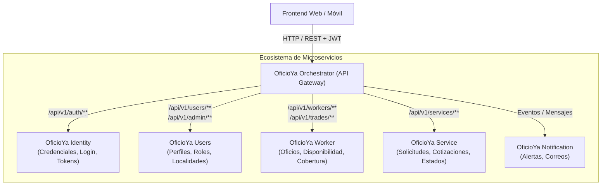

# 🛠️ OficioYa Orchestrator & API Gateway

[](https://www.oracle.com/java/technologies/downloads/#java21)
[](https://spring.io/projects/spring-boot)
[](https://oficioya-orchestor-api-ghaxfaacfabxh4bv.chilecentral-01.azurewebsites.net/swagger-ui/index.html)
[](https://oficioya-orchestor-api-ghaxfaacfabxh4bv.chilecentral-01.azurewebsites.net)

El **Orquestador de OficioYa** actúa como el punto de entrada unificado (**API Gateway**) y coordinador de flujos distribuidos para toda la plataforma OficioYa. Centraliza la autenticación, autorización basada en roles (JWT), enrutamiento inteligente por proxy inverso hacia los microservicios y agregación de respuestas compuestas.

---

## 📐 Documentación, Diagramas y Diseño

Acceso a los diagramas de arquitectura, modelos de dominio y prototipos de la plataforma:

| Recurso | Descripción | Enlace |
| :--- | :--- | :--- |
| **Diagrama C4 (Arquitectura)** | Modelo C4 (Contexto, Contenedores y Componentes) | [Ver en Lucidchart](https://lucid.app/lucidchart/8924d67b-e133-40ee-b6fc-c1b3ac017b33/edit?viewport_loc=-348%2C347%2C1942%2C963%2C0_0&invitationId=inv_d1cf331b-2963-4c69-ad71-cb32d8fa070b) |
| **Diagrama de Clases** | Modelo de dominio y clases del sistema | [Ver en Google Drive](https://drive.google.com/file/d/1IVi8pvH5cWLwDkcuaqaRjFel-94Ye7Gf/view?usp=sharing) |
| **Diagrama de Contenedores** | Vista preliminar de contenedores distribuidos | [Ver en Google Drive](https://drive.google.com/file/d/19WIlKDQu-FZlrHCcUTviBBt9I6yarxVt/view?usp=sharing) |
| **Diagrama Entidad-Relación (ER)** | Modelo de datos de base de datos | [Ver en Google Drive](https://drive.google.com/file/d/1_6IEGdz9Dds-OPQab_qJLSVuQvPBjM_e/view?usp=sharing) |
| **Mockups y Prototipo UI** | Diseño interactivo y flujos de usuario en Figma | [Ver en Figma](https://www.figma.com/design/NvDN2mIs8itoVR14fFOCbU/Flujo-Registro?node-id=0-1&t=Xj3LS6Kx0zLUyBub-1) |
| **Swagger UI (Azure)** | Explorador y pruebas interactivas de endpoints API | [Abrir Swagger UI](https://oficioya-orchestor-api-ghaxfaacfabxh4bv.chilecentral-01.azurewebsites.net/swagger-ui/index.html) |
| **OpenAPI Docs (JSON)** | Especificación OpenAPI 3.0 para clientes HTTP | [Ver v3/api-docs](https://oficioya-orchestor-api-ghaxfaacfabxh4bv.chilecentral-01.azurewebsites.net/v3/api-docs) |

---

## 🏛️ Microservicios y Dominios Orquestados

El orquestador coordina la comunicación y redirige las solicitudes de clientes autenticados y anónimos hacia los microservicios especializados:



* **`Identity Service`:** Autenticación de credenciales, cifrado, emisión y validación de tokens JWT, recuperación de contraseña y OTP.
* **`Users Service`:** Gestión de perfiles de usuario, roles (`CONTRATANTE`, `TRABAJADOR`, `ADMINISTRADOR`), localidades y solicitudes de eliminación de rol.
* **`Worker Service`:** Perfil profesional de trabajador, categorías y oficios, zonas geográficas de cobertura, switch de disponibilidad inmediata y galería de trabajos.
* **`Service Domain`:** Ciclo de vida completo de solicitudes de servicio técnico y domiciliario.
* **`Notification Service`:** Envío de notificaciones transaccionales y confirmaciones.

---

## 🚀 Cómo correr el proyecto en local

### Requisitos previos
* **Java 21 (LTS)**
* **Maven 3.9+** (o el wrapper incluido en el repositorio `mvnw` / `mvnw.cmd`)
* **Docker & Docker Compose** (para base de datos local opcional)

### 1. Iniciar servicios de soporte (Base de Datos)
Desde la carpeta raíz del proyecto:
```bash
cd OficioYa
docker compose up -d
```

### 2. Arrancar la aplicación

#### Opción A: Modo Desarrollo Local (Simulación en memoria)
Usa proveedores de datos simulados en memoria (usuarios y notificaciones locales) sin requerir conexión a todos los microservicios remotos:

* **Windows (PowerShell):**
  ```powershell
  cd OficioYa
  .\mvnw.cmd spring-boot:run "-Dspring-boot.run.profiles=local"
  ```

* **Linux / macOS:**
  ```bash
  cd OficioYa
  ./mvnw spring-boot:run -Dspring-boot.run.profiles=local
  ```

> **Credenciales de prueba (perfil `local`):**
> * **Cliente:** `carlos@oficioya.com`
> * **Administrador:** `admin@oficioya.com`
> *(Sus contraseñas iniciales se configuran en `DevDataSeeder`)*

#### Opción B: Modo Integrado (Conectado a microservicios)
Requiere configurar la clave JWT secreta y las URLs correspondientes:

* **Windows (PowerShell):**
  ```powershell
  $env:JWT_SECRET="TuClaveSecretaEnBase64DeMinimo32Bytes=="
  cd OficioYa
  .\mvnw.cmd spring-boot:run
  ```

* **Linux / macOS:**
  ```bash
  export JWT_SECRET="TuClaveSecretaEnBase64DeMinimo32Bytes=="
  cd OficioYa
  ./mvnw spring-boot:run
  ```

---

## ⚙️ Variables de Entorno

| Variable | Descripción | Valor por defecto |
| :--- | :--- | :--- |
| `SPRING_PROFILES_ACTIVE` | Perfil de configuración (`local`, `prod`) | `local` |
| `JWT_SECRET` | Clave secreta para firmar/validar tokens JWT (Base64, mínimo 32 bytes) | *(Obligatorio fuera de local)* |
| `IDENTITY_URL` | URL base del microservicio `oficioya-identity` | `https://oficioya-identity-api-aeeagjh3cxfph8f8.eastus2-01.azurewebsites.net` |
| `USERS_URL` | URL base del microservicio `oficioYa-users` | `https://oficioya-users-bkeafteuhubdczh6.chilecentral-01.azurewebsites.net` |
| `WORKER_URL` | URL base del microservicio `oficioYa-Worker` | `https://oficioya-worker-api.azurewebsites.net` |
| `SERVICE_URL` | URL base del microservicio `oficioya-service` | `https://oficioya-service-api-d2a8h5d4dqcfc7g5.chilecentral-01.azurewebsites.net` |
| `NOTIFICATION_URL` | URL base del microservicio `oficioya-notification` | `https://oficioya-notification-api-cag3f5ckayfvepg2.chilecentral-01.azurewebsites.net` |
| `PORT` | Puerto de escucha HTTP | `8080` |

---

## 🧪 Pruebas Unitarias e Integración

Para ejecutar la suite completa de pruebas:
```bash
cd OficioYa
./mvnw clean test
```
